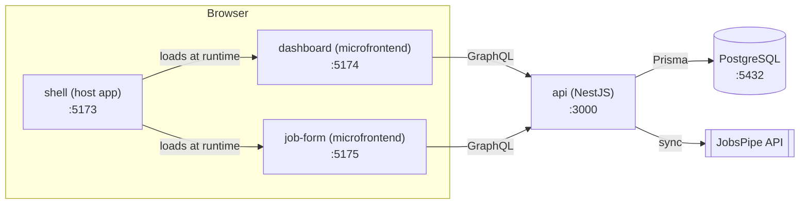

# Job Search Dashboard

A full-stack job search dashboard. It pulls live job postings from the
[JobsPipe](https://jobspipe.dev) API, stores them in PostgreSQL, and shows them in a
sortable, filterable table. You can also add jobs by hand.

> **Status:** step 1 of 4 (project foundation). See the [roadmap](#roadmap).

## Architecture



| App              | What it is                                                        | Port |
| ---------------- | ----------------------------------------------------------------- | ---- |
| `apps/shell`     | Host app: page layout and navigation. Loads the microfrontends.   | 5173 |
| `apps/dashboard` | Microfrontend: the job posts table.                               | 5174 |
| `apps/job-form`  | Microfrontend: form for adding a job by hand.                     | 5175 |
| `apps/api`       | NestJS backend. Holds the JobsPipe token so it never hits the UI. | 3000 |

The microfrontends are separate Vite apps joined with
[Module Federation](https://module-federation.io/). Each can also run on its own,
which is handy while developing.

## Tech stack

- **Frontend:** React 19, Vite, TypeScript (strict), Tailwind CSS 4, Module Federation
- **Backend:** NestJS, PostgreSQL (Docker); GraphQL and Prisma arrive in step 2
- **Quality:** ESLint (typescript-eslint, react-hooks, jsx-a11y, import-x), Prettier,
  Husky + lint-staged, GitHub Actions CI
- **Tests:** Vitest + React Testing Library; MSW, Playwright and Chromatic arrive in later steps
- **Monorepo:** pnpm workspaces + Turborepo

## Getting started

### 1. Install the tools (once)

| Tool                                                              | Why               | Check it works     |
| ----------------------------------------------------------------- | ----------------- | ------------------ |
| [Git](https://git-scm.com/downloads)                              | Version control   | `git --version`    |
| [Node.js 22 LTS](https://nodejs.org/)                             | Runs JavaScript   | `node --version`   |
| pnpm (run `corepack enable` after installing Node)                | Installs packages | `pnpm --version`   |
| [Docker Desktop](https://www.docker.com/products/docker-desktop/) | Runs PostgreSQL   | `docker --version` |
| [VS Code](https://code.visualstudio.com/)                         | Editor            |                    |

On Windows, run `corepack enable` in a terminal opened **as Administrator**.

### 2. Get the code

```bash
git clone https://github.com/mohamedfaizel/job-search-dashboard.git
cd job-search-dashboard
pnpm install
```

When VS Code opens the folder, accept the prompt to install the recommended extensions.

### 3. Configure environment variables

```bash
cp .env.example .env      # Windows PowerShell: Copy-Item .env.example .env
```

`.env` is git-ignored. Your JobsPipe token goes there in step 2. Never commit it.

### 4. Run everything

```bash
pnpm db:up   # start PostgreSQL in Docker
pnpm dev     # start the api and all three frontends
```

Open <http://localhost:5173>. Check the API at <http://localhost:3000/health>.

## Scripts

| Command             | What it does                     |
| ------------------- | -------------------------------- |
| `pnpm dev`          | Run every app in watch mode      |
| `pnpm build`        | Build every app                  |
| `pnpm test`         | Run all unit and component tests |
| `pnpm lint`         | Lint the whole repo              |
| `pnpm typecheck`    | Type-check every app             |
| `pnpm format`       | Format all files with Prettier   |
| `pnpm db:up`/`down` | Start or stop PostgreSQL         |

Run a script for one app with a filter, for example `pnpm --filter @jobsearch/dashboard test`.

A pre-commit hook (Husky + lint-staged) lints and formats the files you commit, so
unformatted code never lands in the repo.

## Roadmap

1. **Foundation** (this step): monorepo, apps, tooling, CI
2. **Backend:** Prisma schema, JobsPipe sync into PostgreSQL, GraphQL API
   (jobs query with filters/sorting, add-job and status mutations)
3. **Frontend:** sortable table with column filters, job description popup,
   add-job form, TanStack Query + Redux Toolkit, Storybook + Chromatic, MSW
4. **End-to-end and publish:** Playwright tests, screenshots, live deploy

Later: scheduled searches, Claude-powered resume builder, application status tracking.
